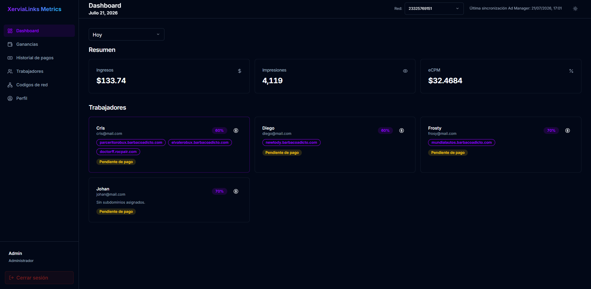
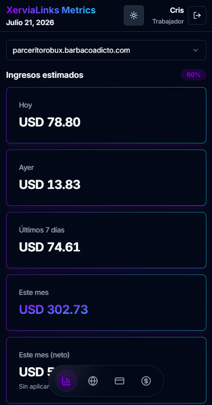
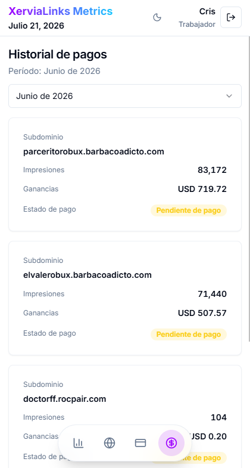
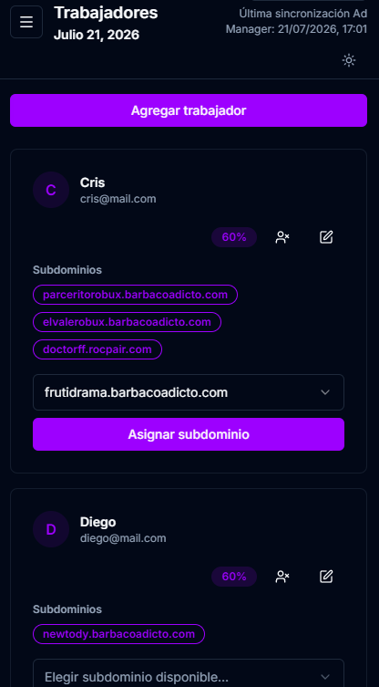
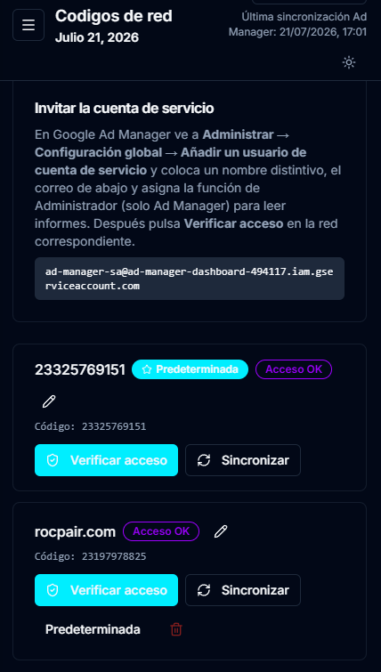

# 📊 XerviaLinks Dashboard

> Una plataforma de métricas para Google Ad Manager (GAM) que sincroniza automáticamente el rendimiento de cada subdominio y lo comparte, de forma aislada y segura, con el editor responsable de ese sitio.

---

## 💼 El Problema del cliente y la Solución

En la industria de los medios digitales, los editores y redes de blogs que utilizan **Google Ad Manager (GAM)** trabajan con varios editores o redactores, cada uno responsable de uno o varios subdominios. Mi cliente tenía que enviar a mano las métricas de cada subdominio a cada editor, un proceso tedioso y propenso a errores.

### 🛑 El Desafío (El Problema)
1. **Falta de granularidad nativa:** Google Ad Manager consolida la información a nivel de red y no ofrece una forma ágil de mostrar a cada editor solo el rendimiento de sus subdominios.
2. **Confidencialidad:** Dar acceso directo a la consola de GAM a colaboradores compromete la seguridad y la privacidad de los datos de toda la red. Sin embargo, no darles acceso les impide seguir el rendimiento de su propio trabajo.
3. **Carga operativa:** Preparar y enviar reportes manuales para cada colaborador consume tiempo y genera errores.

### 🚀 La Solución: XerviaLinks Dashboard
Esta plataforma actúa como una capa sobre la API de Google Ad Manager:
* **Asignación de subdominios:** El administrador vincula subdominios a cada editor.
* **Portal de métricas para colaboradores:** Cada editor accede a un panel privado donde ve únicamente las métricas estimadas de sus subdominios (ingresos estimados, eCPM e impresiones), sin acceso a la consola de GAM.
* **Sincronización automática:** Los datos se sincronizan periódicamente desde GAM y se sirven desde la base de datos propia, sin llamadas en vivo por cada visita.

---

## 📹 Video de Demostración

<!-- 🎬 ESPACIO RESERVADO PARA VIDEO DE DEMOSTRACIÓN -->
<!-- Reemplaza el enlace a continuación con tu video de demostración, enlace de YouTube o GIF animado -->

  <a href="https://youtu.be/5sWEUIRuXsM" target="_blank">
    
    
<strong>Ver la demostración y recorrido completo en video</strong>

  </a>

---

## 🖼️ Capturas de Pantalla

<!-- 📸 ESPACIOS RESERVADOS PARA CAPTURAS DE PANTALLA -->

  <table width="100%">
    <tr>
      <td width="50%" align="center" valign="top">
        <h4>Portal del Trabajador</h4>
        
        
<em>Vista del trabajador con métricas estimadas por subdominio y estadísticas por fechas.</em>

      </td>
      <td width="50%" align="center" valign="top">
        <h4>Modo Oscuro y Claro</h4>
        
        
<em>Conmutador de temas dinámico compatible con esquemas de color claros y oscuros.</em>

      </td>
    </tr>
    <tr>
      <td width="50%" align="center" valign="top">
        <h4>Gestión de Trabajadores</h4>
        
        
<em>Vista del administrador con la gestión de trabajadores y sus dominios asignados.</em>

      </td>
      <td width="50%" align="center" valign="top">
        <h4>Configuración de Códigos de Red</h4>
        
        
<em>Gestión multired de códigos de Google Ad Manager y configuración de credenciales de cuenta de servicio.</em>

      </td>
    </tr>
  </table>

---

## ✨ Características Principales

### 👑 Panel de Control de Administrador
* **Resumen de Métricas:** Ingresos estimados, impresiones, eCPM y trabajadores activos por rango de fechas.
* **Asignación de Trabajadores y Dominios:** Asignación de subdominios a cada trabajador y control de qué estadísticas detalladas pueden ver.
* **Soporte Multired GAM:** Manejo de múltiples códigos de red de Google Ad Manager y configuraciones de credenciales dentro de una sola instancia.
* **Motor de Sincronización Automatizado:** Programador en segundo plano flexible y endpoints de API para sincronizaciones por lotes y llenado retroactivo de datos históricos.

### 👥 Portal de Autoservicio para Trabajadores
* **Métricas de Rendimiento Aisladas:** Cada trabajador consulta solo las métricas estimadas (ingresos, eCPM, impresiones) de sus subdominios asignados.
* **Cambio de Dominio:** Alternancia sencilla entre subdominios gestionados para analizar el rendimiento de cada sitio web.

---

## 🛠️ Stack Tecnológico

| Dominio | Tecnología | Detalles |
| :--- | :--- | :--- |
| **Framework Frontend** | React 18 + Vite | HMR ultrarrápido, arquitectura de UI basada en componentes |
| **Componentes de UI** | Tailwind CSS + Radix UI | Sistema de diseño personalizado, layouts responsivos, íconos Lucide |
| **Motor Backend** | Node.js + Express | Patrón de diseño Clean Architecture / DDD |
| **Base de Datos** | SQLite (`better-sqlite3`) | Base de datos relacional embebida SQL de alta velocidad |
| **Integraciones** | Google Ad Manager API | Integración mediante `google-auth-library` con fallback de datos mock |
| **Autenticación y Seguridad** | JWT + bcrypt | Tokens Bearer seguros, contraseñas encriptadas, limitación de tasa y cabeceras Helmet |
| **Tests** | Jest + Supertest | Pruebas unitarias, de integración y de snapshot |
| **Gestor de Paquetes** | `pnpm` | Gestor de paquetes eficiente listo para monorepos |

---

## 📄 Licencia

Este proyecto está bajo la Licencia [MIT](LICENSE).
