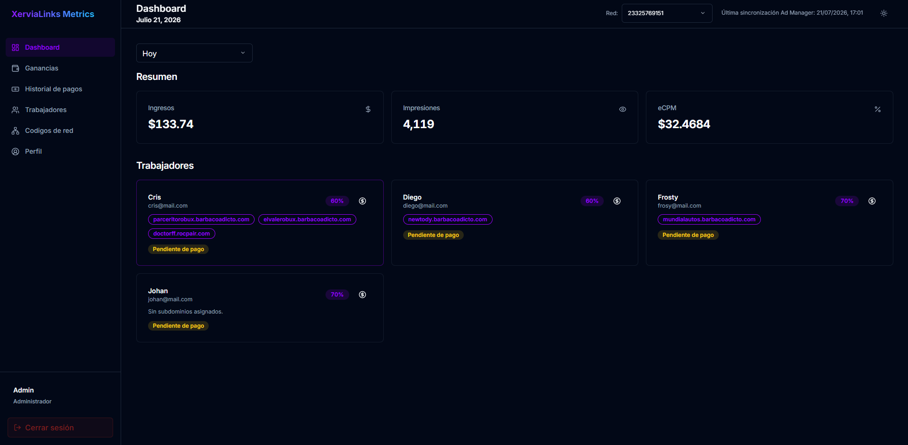
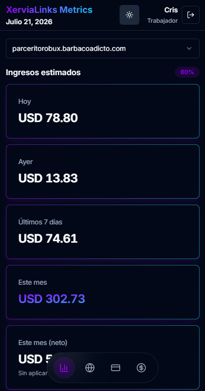
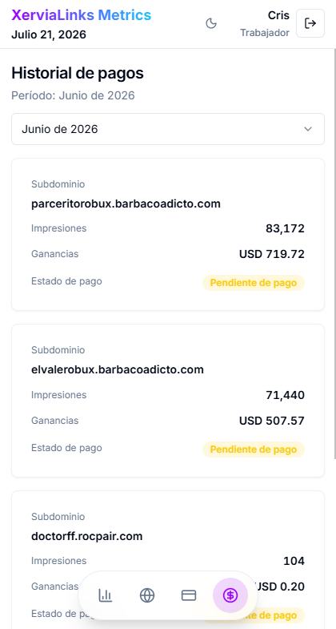
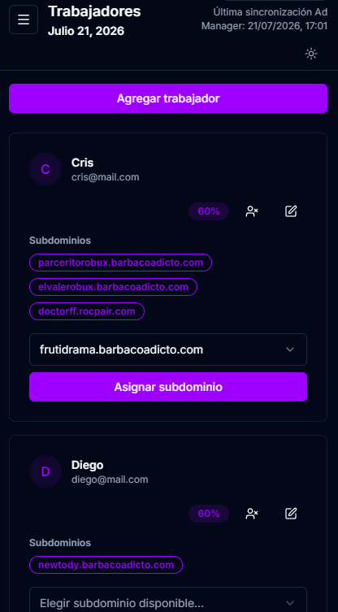
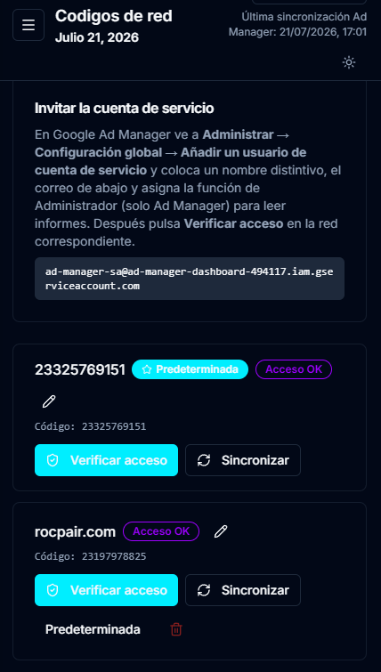

# 📊 XerviaLinks Dashboard

> Una plataforma de análisis y gestión de alto rendimiento para Google Ad Manager (GAM), que permite el seguimiento automatizado de ingresos publicitarios, pagos personalizados a trabajadores y asignación de ingresos por dominio en tiempo real.

---

## 💼 El Problema del cliente y la Solución

En la industria de la monetización de medios digitales, los editores y redes de blogs que utilizan **Google Ad Manager (GAM)** se enfrentan a un reto operativo constante: **la distribución transparente y automatizada de los ingresos publicitarios entre múltiples editores, redactores o socios de contenido.** Este era la problemática que tenía mi cliente al trabajar con varios socios y gestionar sus ganancias. Tenía que enviar manualmente las métricas e ingresos de cada subdominio y gestionar los pagos de cada socio, lo cual era un proceso tedioso y propenso a errores.

### 🛑 El Desafío (El Problema)
1. **Falta de granularidad nativa:** Google Ad Manager consolida la información a nivel de red, pero no cuenta con un sistema nativo ágil para fragmentar y asignar ingresos de forma dinámica por dominio/subdominio a colaboradores individuales con diferentes esquemas de comisión.
2. **Confidencialidad y Opacidad:** Dar acceso directo a la consola de GAM a redactores o colaboradores externos compromete la seguridad y la privacidad de datos globales. Sin embargo, no darles acceso genera desconfianza y fricción al no poder verificar el rendimiento de sus propios artículos.
3. **Carga Administrativa Compleja:** Gestionar el reparto de ingresos mediante hojas de cálculo manuales para decenas de colaboradores a fin de mes es propenso a errores humanos, requiere demasiado tiempo y ralentiza los procesos de pago.

### 🚀 La Solución: XerviaLinks Dashboard
Esta plataforma actúa como una capa de abstracción inteligente sobre la API de Google Ad Manager para resolver este problema de negocio:
* **Asignación y Comisiones a la Medida:** El administrador vincula subdominios a trabajadores específicos y define el porcentaje de ganancia correspondiente de forma individual.
* **Portal de Autoservicio para Colaboradores:** Cada trabajador accede a un panel privado y seguro donde puede visualizar únicamente las métricas de sus dominios asignados (Ingresos Brutos, Ganancias Netas) con total transparencia y en tiempo real.
* **Seguimiento de Pagos Automatizado:** Simplifica la contabilidad permitiendo marcar estados de pago (`Pagado` vs `Pendiente`), registrar el historial de depósitos y garantizar la claridad financiera mutua.

---

## 📹 Video de Demostración

<!-- 🎬 ESPACIO RESERVADO PARA VIDEO DE DEMOSTRACIÓN -->
<!-- Reemplaza el enlace a continuación con tu video de demostración, enlace de YouTube o GIF animado -->

  <a href="https://youtu.be/5sWEUIRuXsM" target="_blank">
    
    
<strong>Ver la demostración y recorrido completo en video</strong>

  </a>

---

## 🖼️ Capturas de Pantalla

<!-- 📸 ESPACIOS RESERVADOS PARA CAPTURAS DE PANTALLA -->

  <table width="100%">
    <tr>
      <td width="50%" align="center" valign="top">
        <h4>Portal del Trabajador</h4>
        
        
<em>Vista del trabajador con desglose por dominios, porcentajes de división de ingresos y estadísticas por fechas.</em>

      </td>
      <td width="50%" align="center" valign="top">
        <h4>Modo Oscuro y Claro</h4>
        
        
<em>Conmutador de temas dinámico compatible con esquemas de color claros y oscuros.</em>

      </td>
    </tr>
    <tr>
      <td width="50%" align="center" valign="top">
        <h4>Gestión de Trabajadores</h4>
        
        
<em>Vista del administrador con la gestión de trabajadores y sus dominios asignados.</em>

      </td>
      <td width="50%" align="center" valign="top">
        <h4>Configuración de Códigos de Red</h4>
        
        
<em>Gestión multired de códigos de Google Ad Manager y configuración de credenciales de cuenta de servicio.</em>

      </td>
    </tr>
  </table>

---

## ✨ Características Principales

### 👑 Panel de Control de Administrador
* **Resumen Completo de Métricas:** Visibilidad en tiempo real de Ingresos Brutos, Ganancias Netas, Pagos Pendientes y Trabajadores Activos.
* **Asignación de Trabajadores y Dominios:** Asignación de dominios a trabajadores con porcentajes de reparto de ingresos personalizados.
* **Gestión de Pagos:** Seguimiento de ganancias mensuales, marcado de estados de pago (`Pagado` vs `Pendiente`) y gestión del historial de pagos.
* **Soporte Multired GAM:** Manejo de múltiples códigos de red de Google Ad Manager y configuraciones de credenciales dentro de una sola instancia.
* **Motor de Sincronización Automatizado:** Programador en segundo plano flexible y endpoints de API para sincronizaciones por lotes y llenado retroactivo de datos históricos.

### 👥 Portal de Autoservicio para Trabajadores
* **Métricas de Rendimiento Aisladas:** Los trabajadores pueden consultar sus ganancias, el desglose del reparto de ingresos y sus historiales de pago específicos para sus dominios asignados.
* **Cambio de Dominio:** Alternancia sencilla entre subdominios gestionados para analizar el rendimiento de cada sitio web.
* **Transparencia en Liquidaciones:** Visibilidad completa sobre el estado de pago del mes actual y registros de desembolsos pasados.

---

## 🛠️ Stack Tecnológico

| Dominio | Tecnología | Detalles |
| :--- | :--- | :--- |
| **Framework Frontend** | React 18 + Vite | HMR ultrarrápido, arquitectura de UI basada en componentes |
| **Componentes de UI** | Tailwind CSS + Radix UI | Sistema de diseño personalizado, layouts responsivos, íconos Lucide |
| **Motor Backend** | Node.js + Express | Patrón de diseño Clean Architecture / DDD |
| **Base de Datos** | SQLite (`better-sqlite3`) | Base de datos relacional embebida SQL de alta velocidad |
| **Integraciones** | Google Ad Manager API | Integración mediante `google-auth-library` con fallback de datos mock |
| **Autenticación y Seguridad** | JWT + bcrypt | Tokens Bearer seguros, contraseñas encriptadas, limitación de tasa y cabeceras Helmet |
| **Tests** | Jest + Supertest | Pruebas unitarias, de integración y de snapshot |
| **Gestor de Paquetes** | `pnpm` | Gestor de paquetes eficiente listo para monorepos |

---

## 📄 Licencia

Este proyecto está bajo la Licencia [MIT](LICENSE).
